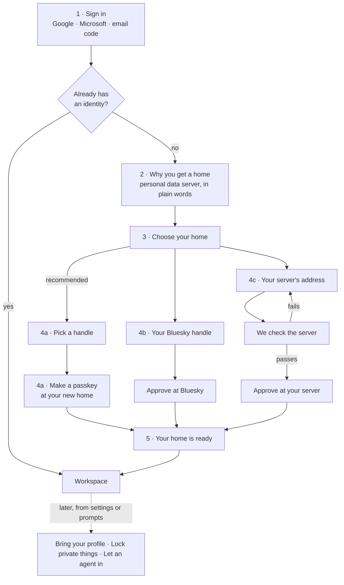

# Onboarding

A new person signs in with an account they already have (Google or Microsoft), learns in plain words why ohm gives them a personal data server, and chooses where that server lives: hosted by ohm, their existing Bluesky account, or a server of their own. When it's done, they have one AT identity (a DID and a handle) linked to their ohm account, and they land in the workspace.

- **Flow id:** `onboarding`. It prefixes every tool name.
- **Starts from:** ohmmmm.com → Get started, or any signed-out page.
- **Ends in:** **ready** (identity linked, workspace open), **paused** (left partway; resumes at the same step), **declined** (cancelled at Google/Microsoft or the PDS; nothing changed), **failed** (a server check failed; the person can fix it or pick another option).

> Status: framework draft, 19 November 2026. The screens are built on sample data in `ohm-onboarding/apps/onboarding/src/flow/` (no real sign-in, PDS or server calls). Tool schemas and API wiring wait until ohm-vault and the private layer are set up.

## The big picture

Three ideas carry the whole flow:

1. **Signing in and having a home are different things.** Google or Microsoft only proves it's you today. Your home (the PDS) is where your identity and public things live. We say this once, early, in plain words.
2. **One choice, three doors.** Hosted, Bluesky and your own server all end in the same state: one AT identity linked to this ohm account. Bluesky is technically "connect an existing server"; it gets its own door because most people who have one think of it as "my Bluesky account", not "a PDS".
3. **Nothing is lost by stopping.** Every step resumes where it left off, on any device, after signing in again with the same Google or Microsoft account.

## Steps

| # | Step | Screen (ohm-ui) | Primary action (forest) | Tool | Annotations | Approval |
| --- | --- | --- | --- | --- | --- | --- |
| 1 | Sign in | `Card` with provider `Button`s; "Use an email code" as a link | Continue with Google | `onboarding.sign-in` | `readOnlyHint` (moves to the provider) | the provider's own screen |
| 2 | Why a home | `Card`, three short points, one illustration | Choose my home | `onboarding.explain` | `readOnlyHint` | none |
| 3 | Choose your home | Three selectable `Card`s (radio), hosted pre-selected | Continue | `onboarding.choose-home` | `readOnlyHint` | none |
| 4a | Pick a handle (hosted) | `Field` + `Input` with live availability | Create my home | `onboarding.create-hosted` | `consequentialHint` (creates a public identity) | `ApprovalCard` |
| 4a′ | Make a passkey (hosted) | Hands off to the PDS passkey screen | Make a passkey | — (device prompt, person only) | — | the device's own prompt |
| 4b | Bluesky handle | `Field` + `Input` (handle) | Continue to Bluesky | `onboarding.connect-bluesky` | `readOnlyHint` (moves to Bluesky) | Bluesky's consent screen |
| 4c | Your server's address | `Field` + `Input` (handle, DID or URL) | Check my server | `onboarding.check-server` | `readOnlyHint` | none |
| 4c′ | Check result | `Card` with a row per check (green / red) | Continue to my server | `onboarding.connect-server` | `readOnlyHint` (moves to the server) | the server's consent screen |
| 5 | Your home is ready | `Card`: handle, where it lives, what signs you in | Open my workspace | `onboarding.finish` | `readOnlyHint` | none |

The passkey step (4a′) and every provider consent screen are person-only on purpose: an agent can walk someone to the door but never through it.

## The words

Draft copy. Short sentences, no protocol names unless the person brings them.

### 1 · Sign in

> **Welcome to ohm**
> Sign in with an account you already have. We use it only to know it's you.
>
> [Continue with Google] [Continue with Microsoft]
> Use an email code instead

If this Google or Microsoft account already has an ohm home, skip straight to the workspace. If it has a half-finished onboarding, go back to that step with "Welcome back. Let's pick up where you left off."

### 2 · Why you get a home

> **Next, your own home on the internet**
>
> ohm doesn't keep your things in its own database. We give you a **personal data server**: a small home that holds your name, your profile and what you choose to make public.
>
> - **It's yours.** Your things live in your home, not inside ohm.
> - **You can leave with it.** If you stop using ohm, your home and everything in it stays with you.
> - **One home, many apps.** The same home signs you in to other apps that use it, like Bluesky. Each app asks before it can do anything.
>
> Private things stay private: they're locked with a key only your devices hold.
>
> [Choose my home]
> What's a personal data server? (opens a short explainer)

### 3 · Choose your home

> **Where should your home live?**
>
> ◉ **Let ohm host it** · Recommended
> We set it up and look after it. Takes a minute.
>
> ○ **Use my Bluesky account**
> Already on Bluesky? Your Bluesky account already has a home. Use the same one.
>
> ○ **Connect my own server**
> You run your own personal data server, or use another provider.
>
> You can move your home later.
>
> [Continue]

### 4a · Hosted: pick a handle, then a passkey

> **Choose your handle**
> This is your name across apps. People can find you by it.
> [ yourname ].ohmmmm.com  ✓ available
>
> [Create my home]

Approval card before creating: "This creates **@yourname.ohmmmm.com**, a public identity. You can change the handle later."

> **Make a passkey for your home**
> A passkey lets you sign in with your face, fingerprint or device PIN. No password to remember.
>
> [Make a passkey]

### 4b · Bluesky

> **Your Bluesky handle**
> [ @you.bsky.social ]
>
> We'll send you to Bluesky to say yes. ohm will be able to use your Bluesky identity; it can't post as you unless you ask it to.
>
> [Continue to Bluesky]

### 4c · Your own server

> **Your server's address**
> Your handle, your DID, or your server's web address.
> [ you.example.com ]
>
> [Check my server]

Then, row by row, green or red:

> ✓ We found your identity
> ✓ Your server is reachable
> ✓ Your server supports signing in to apps
>
> [Continue to my server]

If a row is red, say what's wrong in one sentence and what to try, with "Let ohm host it instead" as a quiet link.

### 5 · Ready

> **Your home is ready**
> **@yourname.ohmmmm.com**
> Hosted by ohm · Signs in with your passkey · Also linked: Google (you@gmail.com)
>
> [Open my workspace]

## After the main path

Not part of first-run. Each is offered later, inside the workspace, when it becomes useful, and each is its own flow.

| Later step | When it's offered | What it does |
| --- | --- | --- |
| Bring your profile | First time they open their profile, or if a Bluesky/own server already has one | Copies the fields they pick from their public profile into a private draft |
| Lock private things | First time they make something private | Creates the ohm unlock passkey and a recovery key for ohm-vault's private layer |
| Let an agent in | First time they connect an agent or the CLI | Issues a scoped, expiring, revocable grant |

## States

| Situation | What the person sees |
| --- | --- |
| Loading | blank, or `LoadingDot` |
| Away at Google, Microsoft, Bluesky or their server | nothing here; on return, the step they left |
| Came back from a provider and said no | the step as it was: "Nothing was changed. Try again when you're ready." |
| Left partway | next sign-in returns to the same step: "Welcome back. Let's pick up where you left off." |
| Handle taken | inline on the field, with two suggestions |
| Own-server check fails | the failing row in red with one plain fix; "Let ohm host it instead" |
| This Bluesky / server identity is already linked to a different ohm account | stop: "This home is already connected to another ohm account. Sign in with that account instead." Never merge |
| Done | step 5, then the workspace |

## Rules this flow keeps

- **Google and Microsoft are sign-in only.** They never create or choose the identity, and matching email addresses never merge two accounts.
- **One identity per account.** ohm never creates a second DID silently. Choosing a door that would create one when one is already linked is refused.
- **Consent happens at the home, not at ohm.** Bluesky's and the person's own server's consent screens, and the hosted PDS's passkey prompt, are where the person says yes.
- **Progress lives on the server.** A remembered step in the browser is a convenience, never proof.

## Open questions

1. **Order of sign-in vs. home for people who already have Bluesky.** Should step 1 also offer "Sign in with Bluesky" for people who have no Google/Microsoft account they want to use? This draft keeps legacy sign-in first, as asked; Bluesky-first would skip step 2 for them.
2. **Hosted handle domain.** `name.ohmmmm.com`, or let people bring their own domain at step 4a?
3. **"You can move your home later."** True for AT identities, but the hosted passkey is tied to the host's domain, so moving means making a new passkey. Keep the promise and explain at move time, or soften the line?
4. **What ohm writes to a Bluesky home.** Public ohm posts would be records on the Bluesky PDS. Say so at step 4b, or at first publish?
5. **Email-code sign-in.** Keep it at step 1 as a fallback, or drop it to keep the first screen to two buttons?

## Checked

- [ ] By hand, in light and dark, on a phone and a desktop
- [ ] By tools: `getTools()` per step, then `executeTool` reaches the same end state
- [ ] Every consequential tool stops at approval; declining and aborting leave nothing behind
